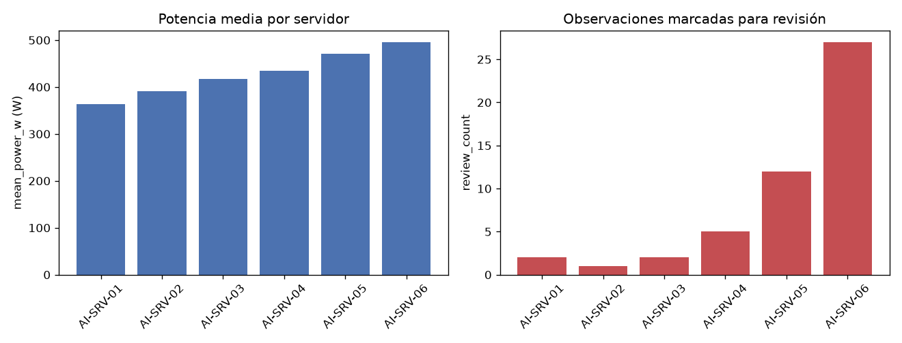

## Tarea 1 - Representar las mediciones

Se implementó `ServerMeasurements`, que almacena la matriz NumPy bidimensional `values` y la tupla `feature_names`, y lanza `ValueError` si la matriz no es bidimensional, si el número de columnas no coincide con la cantidad de nombres o si los datos no son numéricos; las tres validaciones se comprobaron en ejecución y todas se activan correctamente. `__repr__` muestra forma y nombres. `build_measurements(df)` selecciona `gpu_utilization`, `cpu_utilization` y `memory_gb` en ese orden y las convierte a una matriz `float64`. El CSV se leyó con `parse_dates` (`timestamp` queda como `datetime64[us]`) y no se modificó. Sobre las 300 mediciones, el código produce:

```
ServerMeasurements(shape=(300, 3), features=('gpu_utilization', 'cpu_utilization', 'memory_gb'))
```

idéntico al resultado esperado.

## Tarea 2 - Normalizar y calcular un indicador de carga

Sobre la matriz de la Tarea 1 se calcularon, de forma vectorizada, la media y la desviación estándar por columna (ddof=0): means = [57.99313333, 50.54163333, 29.45533333], que coincide con el valor esperado, y stds = [14.4301, 12.6985, 6.5368]. La normalización Z-score, (x − mean) / std con protección frente a desviación estándar cero, produce `zscores` de forma (300, 3); por construcción, cada columna queda con media 0 y desviación 1. El indicador se obtuvo con el producto matricial `zscores @ [0.50, 0.30, 0.20]`, sin recorrer observaciones con `for`, y `load_score` tiene forma (300,).

## Tarea 3 - Identificar observaciones para revisión

Se creó una copia del DataFrame original (300 filas, sin modificarlo) y se agregaron `load_score` (float64, proveniente de la Tarea 2) y `requires_review` (bool), calculada vectorizadamente como `(load_score > 1.5) | (temperature_c > 80)`; el resultado tiene 9 columnas. Quedan 49 filas en `True` y 251 en `False`: 9 por superar load_score 1.5 y 42 por temperatura mayor de 80. La fila 23 obtenida:

| server | timestamp | load_score | temperature_c | requires_review |
|---|---|---|---|---|
| AI-SRV-01 | 2026-08-24 09:55:00 | 3.136218 | 66.97 | True |

coincide con la fila esperada; entra por load_score (3.136218 > 1.5), pues su temperatura es 66.97.

## Tarea 4 - Construir un resumen por servidor

Agrupando por `server` se construyó la tabla con exactamente las columnas `server, observations, mean_power_w, max_temperature_c, mean_load, review_count`, en ese orden; `review_count` cuenta las observaciones del servidor con `requires_review=True`:

| server | observations | mean_power_w | max_temperature_c | mean_load | review_count |
|---|---|---|---|---|---|
| AI-SRV-01 | 50 | 363.4598 | 86.50 | -0.614527 | 2 |
| AI-SRV-02 | 50 | 390.4990 | 76.47 | -0.417730 | 1 |
| AI-SRV-03 | 50 | 416.6088 | 86.50 | -0.085884 | 2 |
| AI-SRV-04 | 50 | 434.8684 | 80.86 | -0.003041 | 5 |
| AI-SRV-05 | 50 | 471.1808 | 86.50 | 0.453583 | 12 |
| AI-SRV-06 | 50 | 495.7276 | 88.01 | 0.667600 | 27 |

La fila de AI-SRV-01 coincide con el resultado esperado del enunciado. En total suma 300 observaciones y 49 revisiones, consistente con la Tarea 3. La carga media crece de AI-SRV-01 (-0.614527) a AI-SRV-06 (0.6676), al igual que la potencia media (363.4598 W a 495.7276 W); AI-SRV-06 concentra 27 de las 49 revisiones.



## Tarea 5 - Guardar y verificar el resultado

El DataFrame analizado de la Tarea 3 se guardó en `output/server_analysis.parquet` con PyArrow 25.0.1 y sin el índice; el archivo (17629 bytes) no lo incluye. Al volver a leerlo y compararlo contra el DataFrame en memoria, las cuatro verificaciones dan True:

```
Round trip verificado: output/server_analysis.parquet
Filas: True
Columnas: True
Esquema: True
Valores: True
```

Filas: 300 antes y 300 después; columnas: 9 antes y 9 después; el esquema coincide, incluidos los metadatos (server: large_string, timestamp: timestamp[us], gpu_utilization, cpu_utilization, memory_gb, power_w, temperature_c y load_score: double, requires_review: bool); los valores son iguales en las nueve columnas. La fila 23 releída coincide con la de la Tarea 3 y se conservan las 49 filas con `requires_review=True`, lo que confirma que la persistencia en Parquet no alteró los datos.
