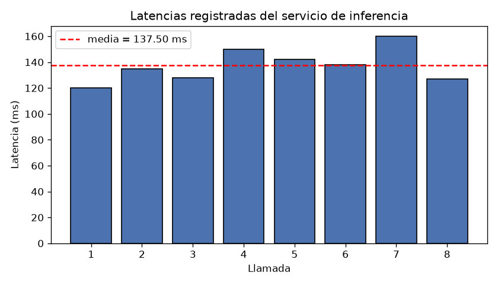

## Datos

Ocho latencias consecutivas del servicio de inferencia, en milisegundos: 120, 135, 128, 150, 142, 138, 160, 127 (n = 8).

## Resultados

| Estadístico | Valor (ms) |
|---|---|
| Media | 137.50 |
| Desviación estándar muestral (n − 1) | 13.07 |
| Error estándar de la media (s/√n) | 4.62 |

## Conclusión

La desviación estándar (13.07 ms) describe la dispersión de las latencias individuales alrededor de la media (137.50 ms): cuánto varía cada llamada respecto al promedio. El error estándar (4.62 ms, obtenido como 13.07/√8) describe la precisión de esa media como estimación: al promediar ocho observaciones, la incertidumbre de la media es menor que la variabilidad de cada latencia.
