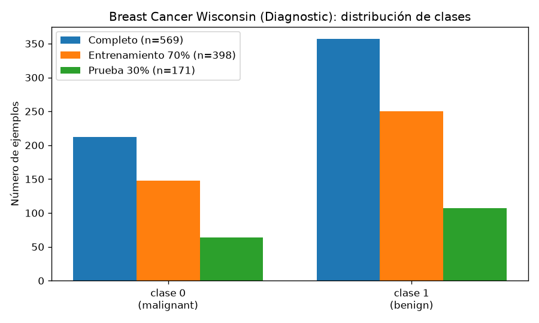
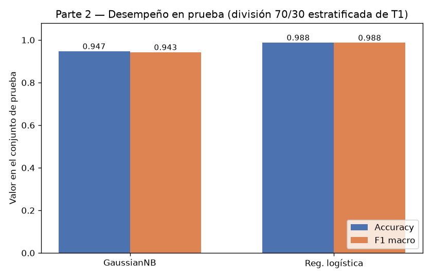
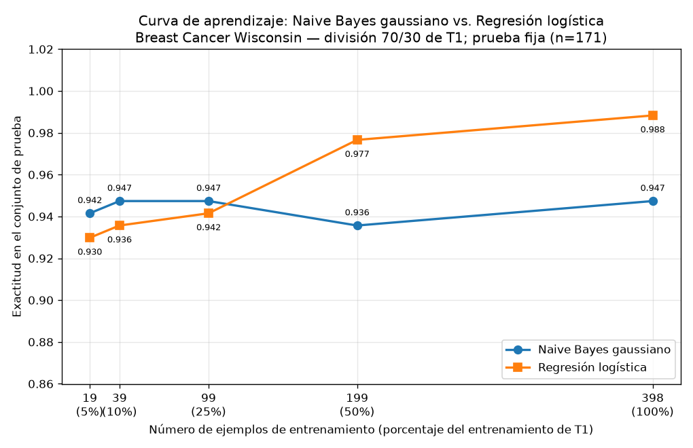

# Tarea A — Generativo contra discriminativo con pocos datos

## Introducción

Ng y Jordan (2002) predijeron teóricamente que un clasificador generativo alcanza su error asintótico con menos ejemplos de entrenamiento que un clasificador discriminativo, aunque ese error asintótico sea mayor. En otras palabras, con pocos datos conviene el modelo generativo, pero con muchos datos el discriminativo lo supera: las curvas de aprendizaje de ambos deben cruzarse. Esta tarea comprueba esa predicción sobre datos reales del conjunto Breast Cancer Wisconsin (Diagnostic), comparando un Naive Bayes gaussiano (generativo) contra una regresión logística (discriminativa) en una curva de aprendizaje sobre una única división train/test.

## Metodología

Se cargó `load_breast_cancer` de scikit-learn, con 569 ejemplos y 30 atributos, y 212 casos de la clase 0 (malignant) y 357 de la clase 1 (benign); las proporciones de clase son 0.3726 y 0.6274 respectivamente. La distribución de clases se muestra en la siguiente figura:

Los datos se dividieron una sola vez en 70 % entrenamiento y 30 % prueba, estratificando por clase y con `random_state=42`. La división resultó en 398 ejemplos de entrenamiento (148 malignant, 250 benign) y 171 de prueba (64 malignant, 107 benign). Este conjunto de prueba no se usó para ajustar nada en toda la tarea.

Se entrenaron dos clasificadores: un GaussianNB con los atributos originales del entrenamiento (sin escalar) y una regresión logística (solver `lbfgs`, `max_iter=5000`, `random_state=42`) cuyos atributos se estandarizaron con un `StandardScaler` ajustado únicamente con el entrenamiento. Ambos se evaluaron sobre el conjunto de prueba con exactitud (accuracy) y F1 macro.

Para la curva de aprendizaje, sobre la misma división, se reentrenaron ambos modelos con submuestras estratificadas del 5 %, 10 %, 25 %, 50 % y 100 % del entrenamiento (`random_state=42`), que corresponden a 19, 39, 99, 199 y 398 ejemplos respectivamente. En cada submuestra el escalador de la regresión logística se reajustó solo con esa submuestra. Cada modelo se evaluó siempre sobre el mismo conjunto de prueba de 171 ejemplos, y se graficó la exactitud contra el número de ejemplos de entrenamiento, guardando la figura en PNG.

## Resultados

### Parte 2 — Comparación con el entrenamiento completo

| Modelo | Accuracy (test) | F1 macro (test) |
|---|---|---|
| Naive Bayes gaussiano | 0.9474 | 0.9429 |
| Regresión logística | 0.9883 | 0.9875 |

Con el entrenamiento completo (398 ejemplos), la regresión logística supera al Naive Bayes gaussiano por 0.0409 en exactitud. Las matrices de confusión sobre el test fueron [[57, 7], [2, 105]] para el Naive Bayes gaussiano y [[63, 1], [1, 106]] para la regresión logística: el modelo generativo comete 9 errores y el discriminativo solo 2.

### Parte 3 — Curva de aprendizaje

| % entrenamiento | n ejemplos | Modelo | Accuracy (test) | F1 macro (test) |
|---|---|---|---|---|
| 5 % | 19 | Naive Bayes gaussiano | 0.9415 | 0.9353 |
| 5 % | 19 | Regresión logística | 0.9298 | 0.9217 |
| 10 % | 39 | Naive Bayes gaussiano | 0.9474 | 0.9420 |
| 10 % | 39 | Regresión logística | 0.9357 | 0.9285 |
| 25 % | 99 | Naive Bayes gaussiano | 0.9474 | 0.9424 |
| 25 % | 99 | Regresión logística | 0.9415 | 0.9363 |
| 50 % | 199 | Naive Bayes gaussiano | 0.9357 | 0.9302 |
| 50 % | 199 | Regresión logística | 0.9766 | 0.9747 |
| 100 % | 398 | Naive Bayes gaussiano | 0.9474 | 0.9429 |
| 100 % | 398 | Regresión logística | 0.9883 | 0.9875 |

## Discusión

Los resultados reproducen el cruce que predicen Ng y Jordan (2002). Con submuestras pequeñas, el Naive Bayes gaussiano gana: en el 5 % (19 ejemplos) su exactitud es 0.9415 frente a 0.9298 de la regresión logística (diferencia de 0.0117 a favor del generativo), en el 10 % (39 ejemplos) la diferencia es de nuevo 0.0117 (0.9474 contra 0.9357) y en el 25 % (99 ejemplos) se reduce a 0.0058 (0.9474 contra 0.9415). El cruce ocurre entre 99 y 199 ejemplos: con el 50 % del entrenamiento la regresión logística invierte la situación con 0.9766 contra 0.9357 (diferencia de 0.0409 a favor del discriminativo), y con el 100 % mantiene la misma ventaja de 0.0409 (0.9883 contra 0.9474).

El comportamiento de cada curva ilustra el compromiso sesgo-varianza. El Naive Bayes gaussiano es esencialmente plano: ya con 19 ejemplos alcanza 0.9415 y en todos los tamaños se mantiene entre 0.9357 y 0.9474, es decir, converge muy rápido a su error asintótico. Esto refleja su baja varianza: al factorizar la densidad conjunta en 30 densidades univariadas, estima muchos menos parámetros y cada uno con poca sensibilidad al tamaño de la muestra. El precio es un sesgo alto: la suposición de independencia condicional entre atributos es falsa en estos datos (atributos como mean radius, mean perimeter y mean area están fuertemente relacionados), y por eso su exactitud asintótica, 0.9474, es claramente inferior a la de la regresión logística.

La regresión logística muestra el patrón opuesto: parte de 0.9298 con 19 ejemplos y mejora de forma casi monótona (0.9357, 0.9415, 0.9766, 0.9883), sin saturarse todavía del todo. Su varianza es mayor porque estima la frontera de decisión conjunta en 30 dimensiones sin imponer la independencia, lo que exige más datos; a cambio, su sesgo es menor y su error asintótico, mejor: 0.9883 contra 0.9474. En términos de Ng y Jordan, el generativo converge antes pero a un techo más bajo, y el discriminativo converge más despacio pero a un techo más alto; el punto de cruce observado entre 99 y 199 ejemplos de entrenamiento es exactamente la transición en la que la menor varianza del generativo deja de compensar su mayor sesgo.

Conviene precisar el alcance: con solo 171 ejemplos de prueba, las diferencias pequeñas (0.0058 en el 25 %) equivalen a uno o dos errores de clasificación, y la leve caída del Naive Bayes en el 50 % (0.9357) muestra una fluctuación de la misma magnitud. La tendencia cualitativa, sin embargo, es consistente en toda la curva y coincide con la predicción teórica.

## Conclusiones

Sobre Breast Cancer Wisconsin, con una única división 70/30 estratificada, se verificó empíricamente la predicción de Ng y Jordan (2002): el Naive Bayes gaussiano alcanza su error asintótico con muy pocos ejemplos (ya con 19 obtiene 0.9415 y se estabiliza en torno a 0.9474), mientras que la regresión logística necesita más datos pero alcanza un error asintótico menor (0.9883 con 398 ejemplos). Las curvas se cruzan entre 99 y 199 ejemplos de entrenamiento: por debajo, conviene el modelo generativo; por encima, el discriminativo. El resultado se explica por el compromiso sesgo-varianza: el generativo tiene mayor sesgo (independencia condicional) pero menor varianza, y el discriminativo menor sesgo pero mayor varianza, que solo se compensa con suficientes datos.
