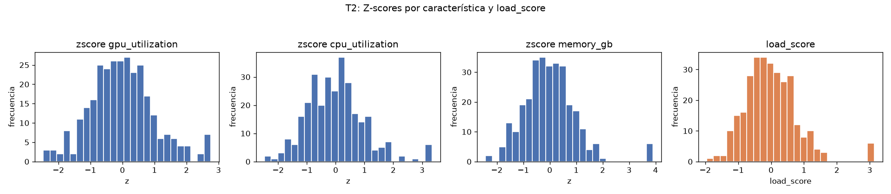
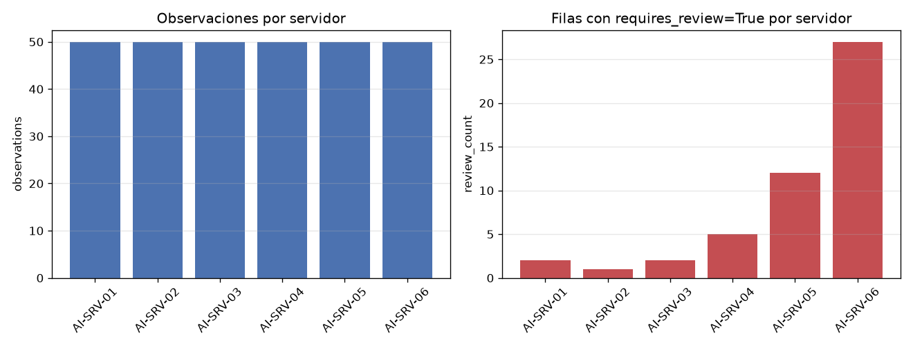

## Tarea 1 - Representar las mediciones

El CSV se cargó con `parse_dates` en `timestamp`: 300 filas y 7 columnas, con `timestamp` de tipo `datetime64[us]`. La clase `ServerMeasurements` almacena `values` (matriz NumPy 2D) y `feature_names` (tupla), y las tres validaciones se verificaron lanzando `ValueError`: matriz no bidimensional, número de columnas distinto de la cantidad de nombres y datos no numéricos. `build_measurements` selecciona `gpu_utilization`, `cpu_utilization` y `memory_gb` en ese orden y devuelve una matriz `float64` de forma (300, 3). El `repr` obtenido coincide con el esperado:

```
ServerMeasurements(shape=(300, 3), features=('gpu_utilization', 'cpu_utilization', 'memory_gb'))
```

El CSV de entrada permaneció sin modificar.

## Tarea 2 - Normalizar y calcular un indicador de carga

Las medias por columna son 57.9931 (`gpu_utilization`), 50.5416 (`cpu_utilization`) y 29.4553 (`memory_gb`), iguales a las obtenidas en T1; las desviaciones estándar son 14.4301, 12.6985 y 6.5368, ninguna cero, por lo que no fue necesaria la división segura. La normalización Z-score, vectorizada y sin bucles sobre observaciones, produjo `zscores` de forma (300, 3) y `load_score` de forma (300,), calculado como `zscores @ [0.50, 0.30, 0.20]`. Las medias por columna de `zscores` fueron 5.6843e-16, 2.3685e-16 y -3.3159e-16, con desviaciones 1.0, 1.0 y 1.0, todas dentro de la tolerancia 1e-10; la verificación de que `load_score` es igual al producto por los pesos resultó verdadera. Resumen de `load_score`: mínimo -1.9556, máximo 3.1362, media 2.6053e-16 y desviación 0.8024.



## Tarea 3 - Identificar observaciones para revisión

Se trabajó sobre una copia del DataFrame; el original quedó intacto. Se agregaron `load_score` y `requires_review` (dtype `bool`), definida vectorizadamente como `load_score > 1.5` o `temperature_c > 80`. Cumplen 49 de las 300 filas. La fila marcada coincide con la esperada por el enunciado:

| | server | timestamp | load_score | temperature_c | requires_review |
|---|---|---|---|---|---|
| 23 | AI-SRV-01 | 2026-08-24 09:55:00 | 3.1362 | 66.97 | True |

## Tarea 4 - Construir un resumen por servidor

Agrupando por `server` se obtuvo una fila por servidor, con las columnas exigidas en el orden correcto:

| server | observations | mean_power_w | max_temperature_c | mean_load | review_count |
|---|---|---|---|---|---|
| AI-SRV-01 | 50 | 363.4598 | 86.50 | -0.6145 | 2 |
| AI-SRV-02 | 50 | 390.4990 | 76.47 | -0.4177 | 1 |
| AI-SRV-03 | 50 | 416.6088 | 86.50 | -0.0859 | 2 |
| AI-SRV-04 | 50 | 434.8684 | 80.86 | -0.0030 | 5 |
| AI-SRV-05 | 50 | 471.1808 | 86.50 | 0.4536 | 12 |
| AI-SRV-06 | 50 | 495.7276 | 88.01 | 0.6676 | 27 |

La fila de AI-SRV-01 reproduce la esperada (363.4598, 86.50, -0.6145, 2). El total es 300 observaciones y 49 revisiones, consistente con T3. La carga media crece de -0.6145 en AI-SRV-01 a 0.6676 en AI-SRV-06, y AI-SRV-06 concentra 27 de las 49 revisiones.



## Tarea 5 - Guardar y verificar el resultado

El DataFrame analizado de T3 se guardó en `output/server_analysis.parquet` con PyArrow 25.0.1 (pandas 3.0.6), sin el índice. Al volver a leerlo, las cuatro verificaciones resultaron verdaderas:

```
Round trip verificado: output/server_analysis.parquet
Filas: True
Columnas: True
Esquema: True
Valores: True
```

En detalle: filas 300 antes y 300 después; columnas 9 antes y 9 después; el esquema Arrow coincide (`server: large_string`, `timestamp[us]`, `double` en las columnas numéricas y `requires_review: bool`), y la diferencia absoluta máxima es 0.0 en las nueve columnas. El archivo quedó en 17629 bytes con 1 row group.
