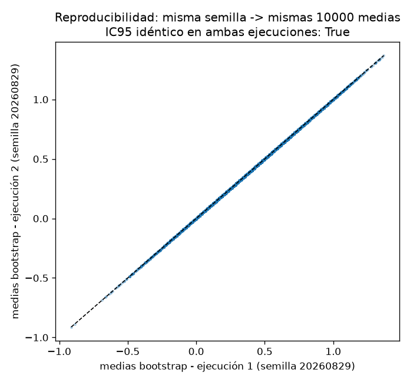

# Informe — Comparación defendible de dos modelos sobre tiendas pareadas

> **Nota de entrega.** La subtarea **T7 (Tarea 7: ejecución del pipeline completo)** no tiene resultado (pendiente): no se reportan sus cifras. El presupuesto de tokens se agotó: se entrega lo que se alcanzó a medir.

## Parte 1. Contrato de análisis previo

*Este contrato se redactó antes de ejecutar la comparación estadística.*

**1. ¿Qué dos modelos se comparan?**
Se comparan los dos modelos de regresión ya entrenados, A y B, que pronostican la demanda semanal de las mismas 16 tiendas (S01–S16). De cada tienda se dispone del error absoluto de cada modelo, en unidades vendidas: columnas `error_a` y `error_b` de `data/model_errors.csv`.

**2. ¿Qué población o proceso objetivo propone para interpretar el ejercicio?**
Propongo como proceso objetivo el proceso generador de errores absolutos de pronóstico semanal en tiendas comparables entre sí, donde cada tienda aporta un par de errores (A, B) medidos sobre las mismas unidades y el interés está en la diferencia media de errores entre modelos. Lo que impide afirmar que los datos representan realmente esa población es su procedencia declarada: son sintéticos, deterministas y creados para esta actividad; no provienen de tiendas reales y no constituyen evidencia sobre una empresa, mercado o población existente, de modo que la generalización al proceso objetivo propuesto es ilustrativa, no empírica.

**3. ¿Cuál es la métrica principal y qué dirección representa un mejor resultado?**
El error absoluto de pronóstico, medido en unidades vendidas. Un error menor es un mejor pronóstico; en la diferencia por tienda, los valores positivos favorecen a B y los negativos a A.

**4. ¿Cuál es la unidad de análisis?**
La tienda pareada: cada unidad es una tienda con un par de errores medidos sobre las mismas observaciones y su diferencia d_i. El conjunto contiene 16 unidades (S01–S16).

**5. ¿Por qué las observaciones están emparejadas y cómo verificará los pares?**
Están emparejadas porque ambos modelos evalúan exactamente las mismas tiendas; la comparación defendible es dentro de cada tienda, no entre grupos independientes. Verificaré los pares mediante la clave `store_id`: unicidad y no nulidad de cada identificador y construcción de la tabla pareada por coincidencia uno a uno sobre esa clave. La igualdad de longitudes de los vectores no se aceptará como evidencia de emparejamiento.

**6. Defina el estimando y la diferencia por tienda. Explique qué significa una diferencia positiva.**
El estimando es Δ = E(d_i), la media poblacional de las diferencias, con d_i = e_A(i) − e_B(i) en la tienda i. Una diferencia positiva significa que el error absoluto de A excede al de B en esa tienda: ahí pronostica mejor B; una diferencia negativa favorece a A.

**7. Escriba la hipótesis nula y la alternativa bilateral.**
H0: Δ = 0 (sin diferencia media de errores entre los modelos) frente a H1: Δ ≠ 0.

**8. ¿Cuál será el procedimiento principal y qué supuestos requiere?**
Prueba t de una muestra sobre el vector de diferencias (equivalente a la t pareada), alternativa bilateral, nivel 0.05. Supuestos: diferencias independientes entre tiendas y aproximadamente normales (o n suficiente para que la referencia t sea razonable), emparejamiento correcto y medición en escala continua. Como referencias complementarias se planearon la prueba exacta por cambios de signo y un bootstrap pareado de sensibilidad.

**9. ¿Qué resultados reportará además del p-value?**
n, media, desviación estándar muestral y error estándar de las diferencias; grados de libertad, estadístico t e intervalo t bilateral del 95 %; total de configuraciones, conteo de extremas y p-value de la referencia exacta por cambios de signo; intervalo bootstrap percentil del 95 % con semilla y número de remuestras; y la evidencia por tienda (tabla pareada y figura de diferencias con referencia visible en cero).

**10. ¿Qué afirmaciones no permite realizar este diseño?**
No permite afirmar causalidad ni generalizar a tiendas, mercados o poblaciones reales (los datos son sintéticos); concluir que un modelo es mejor fuera de esta métrica y muestra; interpretar el p-value como la probabilidad de que H0 sea verdadera; reducir la conclusión a "significativo/no significativo"; ni tratar la no rechazo de H0 como evidencia de equivalencia, en particular con n = 16.

## Parte 2. Auditoría y evidencia por tienda

**11. Confirme que los 16 pares fueron validados mediante `store_id`. Explique por qué comprobar únicamente que ambas columnas tienen la misma longitud no es suficiente.**

Las validaciones ejecutadas sobre `data/model_errors.csv` resultaron verdaderas en todos los casos:

| Validación ejecutada | Resultado |
|---|---|
| Columnas exactas `store_id`, `error_a`, `error_b` | verdadero |
| `store_id` único | verdadero |
| `store_id` no nulo | verdadero |
| Errores numéricos | verdadero |
| Errores finitos | verdadero |
| Errores no negativos | verdadero |
| CSV original no modificado | verdadero |

Las validaciones están implementadas para lanzar `ValueError` (mencionando el identificador, cuando aplica) si alguna falla; en esta ejecución no se lanzó ninguna. El emparejamiento se verificó por `store_id` mediante un merge uno a uno sobre la clave y un mapa `store_id` → (`error_a`, `error_b`), para las 16 tiendas únicas S01–S16 (16 filas en cada columna de errores). La igualdad de longitudes (16 = 16) no se usó como evidencia: dos columnas pueden tener el mismo número de filas y corresponder a tiendas distintas (por ejemplo, con otro orden, un identificador faltante compensado por uno duplicado o un desplazamiento); sin verificación por clave, las diferencias mezclarían errores de tiendas diferentes y invalidarían todo el análisis posterior. Comprobar la longitud demuestra cantidad, no correspondencia.

La tabla pareada (16 filas; columnas `store_id`, `error_a`, `error_b`, `difference`, `favors`) se guardó en `output/store_differences.csv`:

| store_id | error_a | error_b | difference | favors |
|---|---|---|---|---|
| S01 | 12.4 | 10.6 | 1.8 | B |
| S02 | 9.8 | 9.1 | 0.7 | B |
| S03 | 15.1 | 13.9 | 1.2 | B |
| S04 | 11.0 | 12.4 | -1.4 | A |
| S05 | 8.7 | 7.2 | 1.5 | B |
| S06 | 13.6 | 13.9 | -0.3 | A |
| S07 | 10.2 | 9.3 | 0.9 | B |
| S08 | 14.9 | 12.8 | 2.1 | B |
| S09 | 7.5 | 9.3 | -1.8 | A |
| S10 | 16.0 | 15.0 | 1.0 | B |
| S11 | 9.3 | 9.8 | -0.5 | A |
| S12 | 12.8 | 11.1 | 1.7 | B |
| S13 | 11.7 | 12.9 | -1.2 | A |
| S14 | 8.9 | 8.3 | 0.6 | B |
| S15 | 13.2 | 11.9 | 1.3 | B |
| S16 | 10.6 | 11.5 | -0.9 | A |

**12. Indique cuántas tiendas favorecen a A, cuántas favorecen a B y si existen empates. Identifique las diferencias de mayor magnitud en cada dirección.**
10 tiendas favorecen a B (S01, S02, S03, S05, S07, S08, S10, S12, S14, S15) y 6 favorecen a A (S04, S06, S09, S11, S13, S16); no hay empates (0 tiendas con difference = 0). Las diferencias de mayor magnitud son, favoreciendo a B, S08 con difference = 2.1 (error_a 14.9 frente a error_b 12.8) y, favoreciendo a A, S09 con difference = -1.8 (error_a 7.5 frente a error_b 9.3). En la figura `output/store_differences.png` (82 491 bytes) cada tienda tiene una barra horizontal: el signo indica el modelo favorecido, la longitud representa |difference| y el valor está anotado; una línea vertical negra sólida en cero sirve de referencia, con las barras positivas (favorecen a B) en azul (#2c7fb8) y las negativas (favorecen a A) en naranja (#d95f02). La figura hace visible el desbalance 10–6 y las diferencias extremas en cada dirección.

## Parte 3. Efecto e incertidumbre

**13. Reporte el número de tiendas, la diferencia media, la desviación estándar muestral y el error estándar. Interprete el signo y la magnitud de la diferencia media en unidades vendidas.**
Sobre las 16 diferencias: n = 16; media = 0.4187; desviación estándar muestral (ddof = 1) = 1.2534; error estándar = 0.3133, con SE = sd/√n. La suma de diferencias es 6.7 unidades y la mediana 0.8. El signo positivo de la media indica que, en promedio, el error de A excede al de B: B reduce el error absoluto medio en 0.4187 unidades vendidas por tienda respecto de A. La magnitud es moderada y menor que la dispersión entre tiendas: las diferencias van de -1.8 (S09) a 2.1 (S08), y 10 de las 16 tiendas favorecen a B. Distinción clave: la desviación muestral (1.2534) describe cuánto varía el efecto de tienda a tienda (heterogeneidad del fenómeno), mientras que el error estándar (0.3133) describe la incertidumbre de la media muestral como estimación de Δ; el SE disminuye al aumentar n (SE = sd/√n), mientras que la sd no depende de n.

**14. Reporte el intervalo t del 95 %. Explique qué valores del efecto son compatibles con los datos bajo el modelo utilizado. No interprete el intervalo como una probabilidad posterior sobre el parámetro.**
El intervalo t bilateral del 95 % para la media pareada (calculado con `scipy.stats.t.interval`) es [-0.2491, 1.0866], con 15 grados de libertad, SE 0.3133 y t crítico 2.1314. Bajo el modelo utilizado, los valores del efecto compatibles con los datos van de -0.2491 a 1.0866 unidades vendidas: desde una ventaja ligera de A (hasta 0.2491 unidades) hasta una ventaja de B de hasta 1.0866 unidades; el intervalo contiene 0, coherente con no rechazar H0. No es una probabilidad posterior sobre el parámetro: es un procedimiento frecuentista cuya garantía es que, en muestreos repetidos y si los supuestos se cumplen, el 95 % de los intervalos así construidos contiene al verdadero Δ; no afirma que la probabilidad de que Δ esté en este intervalo concreto sea 0.95.

## Parte 4. Referencias nulas y sensibilidad

**15. Reporte el estadístico t, sus grados de libertad y el p-value bilateral. Explique correctamente qué representa ese p-value.**
Prueba t de una muestra sobre las diferencias (`scipy.stats.ttest_1samp`, popmean = 0, alternativa bilateral): estadístico t = 1.3364, gl = 15, p bilateral = 0.2013. Interpretación correcta: si H0 (Δ = 0) fuera verdadera, bajo este diseño (16 tiendas pareadas, alternativa bilateral) y los supuestos del procedimiento (diferencias independientes y aproximadamente normales), la probabilidad de observar un estadístico t con magnitud al menos tan extrema como 1.3364 en cualquier dirección es 0.2013. El p-value es condicional a H0, al diseño y a los supuestos; no es la probabilidad de que H0 sea verdadera ni la probabilidad de que el efecto "no exista". Con p = 0.2013 > 0.05 no se rechaza H0, lo cual no demuestra que Δ = 0.

**16. Reporte el p-value de la prueba exacta por cambios de signo. Explique por qué esta referencia nula y la prueba t no tienen supuestos idénticos.**
Se enumeraron las 2^16 = 65536 configuraciones de signos del vector de diferencias; 13372 produjeron medias nulas con magnitud al menos tan extrema como la observada (6686 en cada cola, con simetría exacta; 896 con magnitud igual a la observada). El p-value exacto es 13372/65536 = 0.2040. Bajo esta referencia, las medias nulas posibles van de -1.1813 a 1.1813, con percentiles 2.5 y 97.5 en -0.6188 y 0.6188. Esta referencia y la prueba t no tienen supuestos idénticos: la t evalúa la media estandarizada contra la distribución t de Student y supone diferencias iid aproximadamente normales; la prueba por cambios de signo construye la referencia nula por enumeración completa y solo requiere que, bajo H0, cada diferencia sea simétrica respecto de 0 (signos equiprobables), sin suponer normalidad. Por eso no son procedimientos intercambiables, aunque aquí sus p-values resulten cercanos (0.2013 frente a 0.2040; diferencia absoluta 0.0027).

**17. Reporte el intervalo bootstrap pareado, la semilla y el número de remuestras. Explique por qué se remuestrean tiendas completas y qué problema no puede corregir automáticamente el bootstrap.**
Bootstrap pareado con `np.random.default_rng`, semilla 20260829 y 10 000 remuestras de tiendas completas: se remuestrea el vector de diferencias (una por tienda); `error_a` y `error_b` nunca se remuestrean por separado. Intervalo percentil del 95 %: [-0.1938, 1.0062]; contiene 0. Estadísticos de apoyo: media bootstrap 0.4210, error estándar bootstrap 0.3056, sesgo 0.0022; la proporción de remuestras con media mayor que cero fue 0.9119. La reproducibilidad se verificó: dos ejecuciones con la misma semilla produjeron el mismo intervalo ([-0.1938, 1.0062] en ambas), con índices de remuestreo idénticos y medias bootstrap idénticas bit a bit; como control, con la semilla 20260830 el intervalo fue [-0.1875, 0.9875], lo que muestra que los extremos dependen de la semilla. La verificación del remuestreo por tiendas completas confirmó que, con los mismos índices de tiendas, media(error_a) − media(error_b) coincide con la media del vector de diferencias remuestreado (diferencia máxima 3.9413e-15).

Se remuestrean tiendas completas porque la unidad de análisis es la tienda pareada: así se preserva el emparejamiento y la correlación dentro de cada tienda entre los errores de A y B; remuestrear los errores por separado rompería ese vínculo y la variabilidad resultante no representaría el diseño pareado. El bootstrap no puede corregir automáticamente sesgos de selección o muestras no representativas, ni dependencias entre tiendas: solo refleja la variabilidad presente en los 16 pares observados y no crea información que la muestra no contiene.

Resumen de las tres referencias:

| Referencia nula / sensibilidad | Resultado |
|---|---|
| t pareada (gl = 15) | t = 1.3364; p = 0.2013; IC t 95 % [-0.2491, 1.0866] |
| Exacta por cambios de signo | 13372 de 65536 configuraciones extremas; p = 0.2040 |
| Bootstrap percentil (semilla 20260829, 10 000 remuestras) | IC 95 % [-0.1938, 1.0062] |

## Parte 5. Informe ejecutivo

**18. Informe ejecutivo (máximo 150 palabras).**

Unidad: 16 tiendas pareadas; datos sintéticos y deterministas, creados para el ejercicio, sin evidencia sobre tiendas reales. Métrica: error absoluto de pronóstico en unidades vendidas (menor es mejor); emparejamiento verificado por store_id. Efecto: diferencia media error_a − error_b de 0.4187 unidades a favor de B (desviación muestral 1.2534; error estándar 0.3133). Procedimiento: prueba t bilateral de una muestra sobre las diferencias: t(15) = 1.3364, p = 0.2013; intervalo t del 95 %: [-0.2491, 1.0866]. Sensibilidad: bootstrap pareado percentil (semilla 20260829, 10 000 remuestras): [-0.1938, 1.0062]; prueba exacta por cambios de signo: p = 0.2040. Limitaciones: n = 16 implica potencia limitada; los datos son sintéticos y no representan ninguna población real. No puede concluirse que B reduzca el error en tiendas reales ni que los modelos sean equivalentes; solo que, en estos datos, el efecto medio no se distingue de cero.
