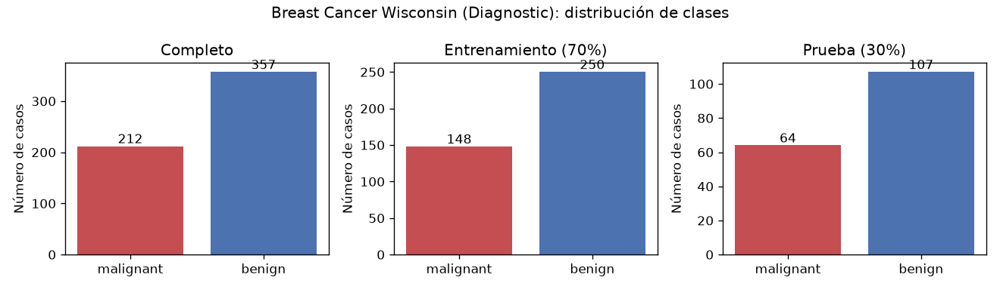
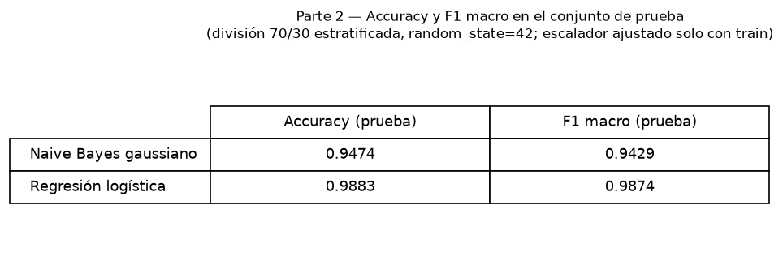
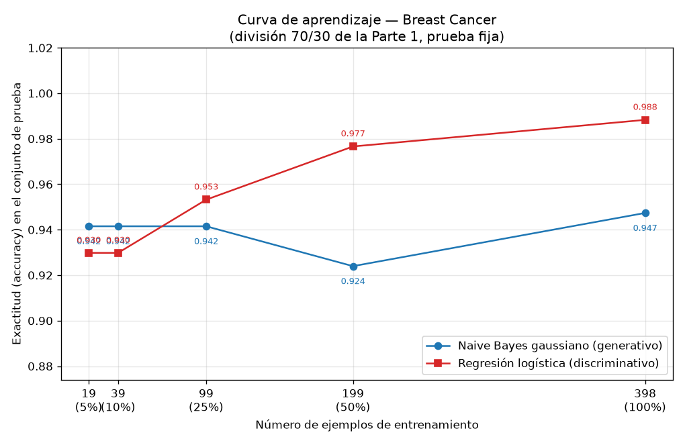

## Introducción

Ng y Jordan (2002) predijeron teóricamente que un clasificador generativo alcanza su error asintótico con menos ejemplos de entrenamiento que su par discriminativo, aunque ese error asintótico sea mayor. Esta tarea comprueba esa predicción sobre datos reales usando el conjunto Breast Cancer Wisconsin (Diagnostic): se enfrentan un Naive Bayes gaussiano (generativo) y una regresión logística (discriminativa) en una curva de aprendizaje sobre una única división entrenamiento/prueba, y se discute el resultado en términos de sesgo y varianza.

## Metodología

**Datos y división.** Se cargó el conjunto Breast Cancer Wisconsin (Diagnostic) con `sklearn.datasets.load_breast_cancer`, que contiene 569 ejemplos con 30 atributos, con 212 casos de la clase `malignant` y 357 de la clase `benign`. Se creó una división 70 %/30 % estratificada por clase con `random_state=42`, que produjo 398 ejemplos de entrenamiento (148 `malignant`, 250 `benign`) y 171 de prueba (64 `malignant`, 107 `benign`). Esta división es la única usada en toda la tarea: el conjunto de prueba no se tocó para ajustar nada.

**Modelos.** Se entrenaron un Naive Bayes gaussiano y una regresión logística. En ambos casos los atributos se estandarizaron con `StandardScaler` ajustado únicamente con el conjunto de entrenamiento (nunca con el de prueba).

**Curva de aprendizaje.** Sobre la misma división, se reentrenaron los dos modelos con submuestras estratificadas del entrenamiento correspondientes al 5 %, 10 %, 25 %, 50 % y 100 % (19, 39, 99, 199 y 398 ejemplos; `random_state=42`), reajustando el escalador solo con cada submuestra. Cada modelo se evaluó siempre sobre el mismo conjunto de prueba de 171 ejemplos, midiendo exactitud y F1 macro.

## Resultados

**Parte 2 — Desempeño con el entrenamiento completo (398 ejemplos).**

| Modelo | Accuracy (prueba) | F1 macro (prueba) |
|---|---|---|
| Naive Bayes gaussiano | 0.9474 | 0.9429 |
| Regresión logística | 0.9883 | 0.9874 |

Con el entrenamiento completo, la regresión logística supera al Naive Bayes por 0.0409 de exactitud (0.9883 frente a 0.9474) y por 0.0445 de F1 macro (0.9874 frente a 0.9429).

**Parte 3 — Curva de aprendizaje.** La composición de las submuestras estratificadas fue: 19 ejemplos (7 `malignant`, 12 `benign`), 39 (15/24), 99 (37/62), 199 (74/125) y 398 (148/250). Los valores de exactitud sobre el conjunto de prueba fijo fueron:

| n entrenamiento | % | Accuracy NB | Accuracy RL |
|---|---|---|---|
| 19 | 5 | 0.9415 | 0.9298 |
| 39 | 10 | 0.9415 | 0.9298 |
| 99 | 25 | 0.9415 | 0.9532 |
| 199 | 50 | 0.9240 | 0.9766 |
| 398 | 100 | 0.9474 | 0.9883 |

Los valores con 398 ejemplos coinciden exactamente con los de la Parte 2, lo que confirma la consistencia del protocolo. El modelo ganador por tamaño fue el Naive Bayes con 19 y 39 ejemplos, y la regresión logística con 99, 199 y 398 ejemplos; las curvas se cruzan entre 39 y 99 ejemplos de entrenamiento.

## Discusión

Los resultados reproducen el patrón cualitativo de Ng y Jordan. Con muy pocos datos, el modelo generativo gana: con 19 y 39 ejemplos el Naive Bayes alcanza 0.9415 de exactitud frente a 0.9298 de la regresión logística, una ventaja de 0.0117. A partir de 99 ejemplos el orden se invierte y la regresión logística domina de forma creciente, llegando a 0.9883 contra 0.9474 con los 398 ejemplos disponibles. Se observa, por tanto, el cruce predicho: el generativo converge antes, pero a un nivel asintótico peor; el discriminativo necesita más datos, pero alcanza un techo más alto.

La forma de las curvas lo explica en términos de sesgo y varianza. La curva del Naive Bayes es casi plana: 0.9415 con 19, 39 y 99 ejemplos, un descenso a 0.9240 con 199 (ruido de muestreo de esa submuestra) y 0.9474 con 398. Esa estabilidad temprana refleja su baja varianza: al factorizar la densidad conjunta en 30 densidades condicionales univariadas, estima pocos parámetros por clase y converge rápido. El costo es un sesgo alto: la hipótesis de independencia condicional entre atributos es falsa en estos datos (son medidas morfológicas de núcleos celulares fuertemente correlacionadas), lo que limita su error asintótico y explica que con todo el entrenamiento quede 0.0409 por debajo de la regresión logística.

La regresión logística muestra el comportamiento opuesto: sube de forma monótona de 0.9298 (19 y 39 ejemplos) a 0.9532 (99), 0.9766 (199) y 0.9883 (398). Al no imponer independencia condicional, su sesgo es menor y su error asintótico inferior; el precio es una varianza mayor con pocos datos, pues debe estimar un peso por atributo sin descomponer el problema, y con 19 o 39 ejemplos eso se traduce en la desventaja inicial frente al Naive Bayes. En resumen: con menos de unos 99 ejemplos conviene el generativo; con 99 o más, el discriminativo, y la brecha a favor de este último crece con el tamaño de entrenamiento.

## Conclusiones

Sobre Breast Cancer Wisconsin, con una única división 70 %/30 % estratificada (`random_state=42`), el experimento confirma el comportamiento predicho por Ng y Jordan: el Naive Bayes gaussiano, generativo, alcanza su desempeño casi asintótico ya con 19 ejemplos (0.9415) y se mantiene estable, mientras que la regresión logística, discriminativa, mejora continuamente con el tamaño de entrenamiento hasta 0.9883 con 398 ejemplos. Las curvas se cruzan entre 39 y 99 ejemplos: con muy pocos datos conviene el modelo generativo por su baja varianza; con datos suficientes conviene el discriminativo por su menor sesgo y mejor error asintótico. La elección óptima de modelo depende, por tanto, del presupuesto de datos disponible, exactamente como anticipa la teoría.
