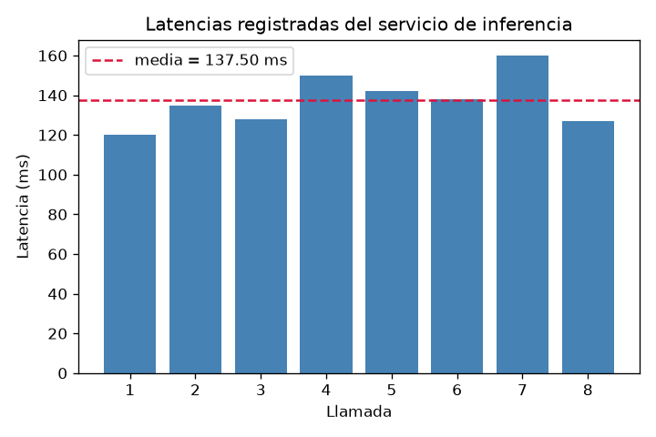

## Datos

Ocho latencias consecutivas de un servicio de inferencia, en milisegundos: 120, 135, 128, 150, 142, 138, 160, 127 (n = 8).



## Resultados

Media = 137.50 ms; desviación estándar muestral (n − 1) = 13.07 ms; error estándar de la media = 4.62 ms.

```python
import numpy as np
x = np.array([120, 135, 128, 150, 142, 138, 160, 127])
media = x.mean()
de = x.std(ddof=1)
ee = de / np.sqrt(x.size)
```

## Conclusión

La desviación estándar (13.07 ms) describe la dispersión de las latencias individuales alrededor de la media (137.50 ms): cuánto varía una llamada típica respecto de otra. El error estándar (4.62 ms) describe la precisión de la media muestral como estimación del promedio poblacional del servicio y disminuye al aumentar n.
