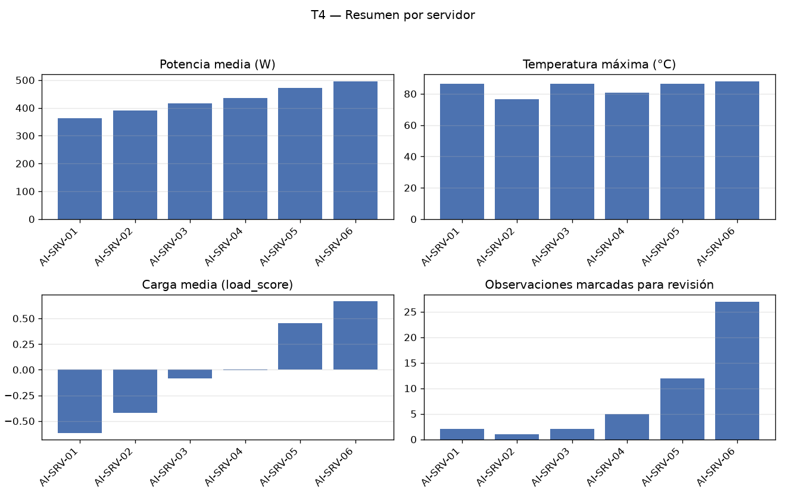

## Tarea 1 - Representar las mediciones

La clase `ServerMeasurements` almacena la matriz `values` y la tupla `feature_names`, y lanza `ValueError` en los tres casos exigidos; las tres validaciones se ejecutaron con resultado positivo (matriz no bidimensional, número de columnas distinto de la cantidad de nombres y datos no numéricos). `build_measurements(df)` selecciona `gpu_utilization`, `cpu_utilization` y `memory_gb` en ese orden y convierte a flotante. El repr obtenido:

```
ServerMeasurements(shape=(300, 3), features=('gpu_utilization', 'cpu_utilization', 'memory_gb'))
```

La matriz resultante tiene 300 filas y 3 columnas, con dtype float64; sus tres primeras filas son [59.61, 59.61, 24.87], [49.49, 52.64, 27.73] y [65.62, 47.06, 26.34].

## Tarea 2 - Normalizar y calcular un indicador de carga

Con operaciones vectorizadas (sin bucles sobre observaciones) se calcularon las medias por columna: 57.9931, 50.5416 y 29.4553, y las desviaciones estándar usadas en la división: 14.4301, 12.6985 y 6.5368; la guarda contra desviación cero no alteró ningún valor porque ninguna desviación fue 0. Tras el Z-score, `zscores` tiene forma (300, 3) y `load_score` forma (300,). Las medias por columna de `zscores` fueron 5.6843e-16, 2.3685e-16 y -3.3159e-16, y las desviaciones 1.0, 1.0 y 1.0, dentro de la tolerancia 1e-10. `load_score` quedó definido como `zscores @ [0.50, 0.30, 0.20]`; su media es 2.6053e-16, su desviación 0.8024, su mínimo -1.9556 y su máximo 3.1362. Hay 9 observaciones con load_score > 1.5.

## Tarea 3 - Identificar observaciones para revisión

Se creó una copia del DataFrame original (300 filas, sin modificarlo) y se agregaron `load_score` (float64) y `requires_review` (bool), definida vectorizadamente como `load_score > 1.5` o `temperature_c > 80`. El resultado tiene 9 columnas: las 7 originales más las 2 agregadas. Quedaron marcadas 49 filas: 9 por load_score > 1.5, 42 por temperature_c > 80 y 2 por ambas condiciones. La fila 23 obtenida:

| server | timestamp | load_score | temperature_c | requires_review |
|---|---|---|---|---|
| AI-SRV-01 | 2026-08-24 09:55:00 | 3.1362 | 66.97 | True |

Coincide con el resultado esperado: se marca por superar el umbral de load_score, con temperatura de 66.97 por debajo de 80.

## Tarea 4 - Construir un resumen por servidor

Agrupando por `server` (50 observaciones por servidor) se obtuvo la tabla con exactamente las columnas exigidas, en el orden pedido:

| server | observations | mean_power_w | max_temperature_c | mean_load | review_count |
|---|---|---|---|---|---|
| AI-SRV-01 | 50 | 363.4598 | 86.5 | -0.6145 | 2 |
| AI-SRV-02 | 50 | 390.499 | 76.47 | -0.4177 | 1 |
| AI-SRV-03 | 50 | 416.6088 | 86.5 | -0.0859 | 2 |
| AI-SRV-04 | 50 | 434.8684 | 80.86 | -0.0030 | 5 |
| AI-SRV-05 | 50 | 471.1808 | 86.5 | 0.4536 | 12 |
| AI-SRV-06 | 50 | 495.7276 | 88.01 | 0.6676 | 27 |



Los review_count suman 49, igual que las filas marcadas en la Tarea 3, lo que confirma la consistencia entre ambas tablas. AI-SRV-06 concentra 27 revisiones y la temperatura máxima global (88.01); además, mean_load crece de -0.6145 en AI-SRV-01 a 0.6676 en AI-SRV-06, en línea con el aumento de mean_power_w de 363.4598 a 495.7276.

## Tarea 5 - Guardar y verificar el resultado

El DataFrame analizado de la Tarea 3 se guardó en `output/server_analysis.parquet` con PyArrow (`write_table`, sin índice) y se volvió a leer. Las cuatro verificaciones mínimas:

- Filas: True (300 antes == 300 después)
- Columnas: True (9 antes == 9 después)
- Esquema: True (mismos tipos en ambos lados: str, timestamp[us], double para las seis columnas numéricas y bool para requires_review)
- Valores: True (diferencia absoluta máxima de 0.0 en los flotantes)

Mensaje obtenido: `Round trip verificado: output/server_analysis.parquet`. Como comprobación adicional, el archivo leído conserva las 49 filas con `requires_review=True` coincidentes con la Tarea 3 y la fila 23 idéntica (load_score 3.1362, temperature_c 66.97, requires_review True), con lo que el Parquet preserva el contrato de los datos end-to-end.
