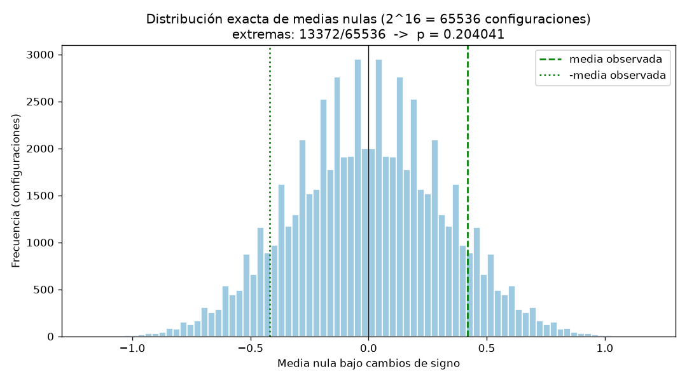

> **Declaraciones de entrega.** (1) La subtarea T7 (Tarea 7: ejecución del pipeline completo en una sola corrida) no tiene resultado (pendiente): no se reportan sus cifras. (2) El presupuesto de tokens se agotó: se entrega lo que se alcanzó a medir. Por dependencia, la respuesta 18 (Parte 5) queda pendiente y no se redacta con cifras no medidas.

## Parte 1. Contrato de análisis previo

**1. ¿Qué dos modelos se comparan?**
Se comparan dos modelos de regresión ya entrenados, A y B, que pronostican la demanda semanal de las mismas 16 tiendas. La comparación se realiza sobre el error absoluto de cada modelo, registrado en `data/model_errors.csv` con las columnas `store_id`, `error_a` y `error_b`.

**2. ¿Qué población o proceso objetivo propone para interpretar el ejercicio?**
Propongo como proceso objetivo el proceso generador de errores de pronóstico de la demanda semanal en tiendas comparables, del cual las 16 tiendas del archivo serían una muestra de unidades pareadas; el estimando se referiría a la diferencia media de errores sobre ese proceso. Lo que impide afirmar que los datos sintéticos representan realmente esa población es su procedencia: son datos sintéticos, deterministas y creados para la actividad, no provienen de tiendas reales ni de un mecanismo de muestreo aleatorio documentado; con 16 valores fijos no hay marco muestral ni garantía de representatividad, de modo que la referencia poblacional es una construcción didáctica.

**3. ¿Cuál es la métrica principal y qué dirección representa un mejor resultado?**
La métrica principal es el error absoluto de pronóstico, medido en unidades vendidas. Un valor menor representa un mejor pronóstico: la dirección favorable es hacia abajo.

**4. ¿Cuál es la unidad de análisis?**
La tienda. Cada una de las 16 tiendas aporta un par de errores (error_a, error_b) y una diferencia d_i; el tamaño muestral del análisis es n = 16 tiendas.

**5. ¿Por qué las observaciones están emparejadas y cómo verificará los pares?**
Están emparejadas porque ambos modelos se evalúan sobre las mismas unidades: cada fila contiene los dos errores de la misma tienda, y la variabilidad entre tiendas afecta a ambos modelos por igual. Verificaré los pares mediante una unión 1:1 por la clave `store_id`, comprobando que las columnas sean exactamente las esperadas, que cada identificador sea único y no nulo, y que los errores sean numéricos, finitos y no negativos. Comprobar únicamente que ambos vectores tengan la misma longitud no demuestra que correspondan a las mismas tiendas.

**6. Defina el estimando y la diferencia por tienda. Explique qué significa una diferencia positiva.**
El estimando es Δ = E[d_i], la media de las diferencias por tienda, con d_i = e_A(i) − e_B(i). Una diferencia positiva significa que el error de A es mayor que el de B en esa tienda, es decir, B pronostica mejor: por convención, diferencia positiva favorece a B y diferencia negativa favorece a A.

**7. Escriba la hipótesis nula y la alternativa bilateral.**
H0: Δ = 0 (no hay diferencia media entre los errores de A y B). H1: Δ ≠ 0 (alternativa bilateral).

**8. ¿Cuál será el procedimiento principal y qué supuestos requiere?**
Prueba t de una muestra sobre el vector de diferencias, con alternativa bilateral. Supuestos: las diferencias d_i son una muestra aleatoria de una población de diferencias aproximadamente normal (o n suficientemente grande), hay independencia entre tiendas, la métrica es continua y los pares están correctamente alineados por tienda.

**9. ¿Qué resultados reportará además del p-value?**
Reportaré n, la media, la desviación estándar muestral y el error estándar de las diferencias; el estadístico t y sus grados de libertad; el intervalo t bilateral del 95 %; el p-value exacto por cambios de signo con el total de configuraciones y el conteo de extremas; el intervalo bootstrap percentil del 95 % con su semilla y número de remuestras; y la evidencia por tienda (conteos por modelo y diferencias de mayor magnitud) con una figura con referencia visible en cero.

**10. ¿Qué afirmaciones no permite realizar este diseño?**
No permite generalizar a tiendas, mercados o poblaciones reales, porque los datos son sintéticos y deterministas; no garantiza representatividad ni muestreo aleatorio; no establece causalidad ni explica por qué un modelo supera al otro; con n = 16 la potencia es limitada; no rechazar H0 no equivale a demostrar que Δ = 0; y el p-value no puede interpretarse como la probabilidad de que la hipótesis nula sea verdadera.

## Parte 2. Auditoría y evidencia por tienda

**11. Confirme que los 16 pares fueron validados mediante store_id.**
La auditoría confirmó: columnas exactas (`store_id`, `error_a`, `error_b`), 16 filas, 0 identificadores nulos, identificadores únicos, errores numéricos, finitos y no negativos, y CSV original intacto. Los pares se construyeron mediante una unión 1:1 por la clave `store_id` (no por posición), con lo que quedaron validados los 16 pares S01–S16. Comprobar únicamente que `error_a` y `error_b` tengan la misma longitud verifica el tamaño de los vectores, no la correspondencia entre filas: un reordenamiento, un id duplicado o un id faltante emparejaría tiendas distintas sin detectarlo. Es la clave única `store_id` la que garantiza que cada diferencia compare los errores de la misma tienda.

**12. Tiendas que favorecen a cada modelo y diferencias de mayor magnitud.**
10 tiendas favorecen a B (S01, S02, S03, S05, S07, S08, S10, S12, S14, S15) y 6 favorecen a A (S04, S06, S09, S11, S13, S16); hay 0 empates y los conteos suman 16. La diferencia positiva de mayor magnitud es S08 con +2.1 (error_a 14.9 frente a error_b 12.8) y la negativa de mayor magnitud es S09 con −1.8 (7.5 frente a 9.3).

| store_id | error_a | error_b | difference | favors |
|---|---|---|---|---|
| S01 | 12.4 | 10.6 | 1.8 | B |
| S02 | 9.8 | 9.1 | 0.7 | B |
| S03 | 15.1 | 13.9 | 1.2 | B |
| S04 | 11.0 | 12.4 | -1.4 | A |
| S05 | 8.7 | 7.2 | 1.5 | B |
| S06 | 13.6 | 13.9 | -0.3 | A |
| S07 | 10.2 | 9.3 | 0.9 | B |
| S08 | 14.9 | 12.8 | 2.1 | B |
| S09 | 7.5 | 9.3 | -1.8 | A |
| S10 | 16.0 | 15.0 | 1.0 | B |
| S11 | 9.3 | 9.8 | -0.5 | A |
| S12 | 12.8 | 11.1 | 1.7 | B |
| S13 | 11.7 | 12.9 | -1.2 | A |
| S14 | 8.9 | 8.3 | 0.6 | B |
| S15 | 13.2 | 11.9 | 1.3 | B |
| S16 | 10.6 | 11.5 | -0.9 | A |

La figura `output/store_differences.png` (verificada: existe, 87685 bytes) muestra una barra horizontal divergente por tienda, ordenadas por difference (S08, S01, S12, S05, S15, S03, S10, S07, S02, S14, S06, S11, S16, S13, S04, S09), con línea de referencia visible en cero. El lado respecto de 0 y el color codifican el signo (azul: difference > 0, favorece a B; rojo: difference < 0, favorece a A); la longitud de la barra codifica la magnitud, con etiquetas numéricas a 2 decimales al final de cada barra y en negrita las de mayor magnitud en cada dirección.

## Parte 3. Efecto e incertidumbre

**13. Número de tiendas, diferencia media, desviación muestral y error estándar.**
Con n = 16 tiendas: media de las diferencias = 0.4187 unidades vendidas, desviación estándar muestral = 1.2534 y error estándar = 0.3133 (= sd/√16). El signo positivo indica que, en promedio, el error de A supera al de B en 0.4187 unidades vendidas por tienda; bajo la convención d_i = e_A − e_B, el efecto apunta a favor de B, con una magnitud menor a medio punto de la métrica. La desviación muestral (1.2534) describe la dispersión de las diferencias entre tiendas; el error estándar (0.3133) describe la incertidumbre de la media. No deben confundirse: aquí sd ≈ 4.00 × SE (razón sd/SE = 4.0, consistente con sd = √n · SE para n = 16).

**14. Intervalo t del 95 %.**
El intervalo t bilateral del 95 % para la media pareada es [−0.2491, 1.0866] unidades vendidas (t crítico = 2.1314 con 15 grados de libertad; margen de error = 0.6679; verificado con `scipy.stats.t.interval`). Bajo el modelo t utilizado, los valores del efecto medio compatibles con los datos van de −0.2491 a 1.0866 unidades: el intervalo incluye 0, de modo que una diferencia media nula es compatible con los datos. La interpretación es frecuentista: en muestreos repetidos, el 95 % de los intervalos construidos así cubriría el verdadero Δ; no es una probabilidad posterior sobre el parámetro.

## Parte 4. Referencias nulas y sensibilidad

**15. Estadístico t, grados de libertad y p-value bilateral.**
Estadístico t = 1.3364 con 15 grados de libertad y p-value bilateral = 0.2013; a un nivel de 0.05 no se rechaza H0. El p-value representa, condicional a la hipótesis nula Δ = 0 y a los supuestos del diseño (diferencias pareadas por tienda, muestra aleatoria de diferencias aproximadamente normal), la probabilidad de observar un estadístico t con magnitud al menos tan extrema como 1.3364. No es la probabilidad de que H0 sea verdadera, ni la probabilidad de que los datos sean producto del azar sin más.

**16. Prueba exacta por cambios de signo.**
Se enumeraron de forma exhaustiva y determinista las 2^16 = 65536 configuraciones de signos del vector de diferencias; 13372 produjeron medias nulas con magnitud al menos tan extrema como la observada (0.4187), para un p-value exacto de 0.2040 = 13372/65536. El desglose es 12476 configuraciones estrictamente más extremas y 896 igualmente extremas, con colas simétricas de 6686 cada una. Bajo esta referencia nula, la distribución de medias tiene media 0, desviación 0.3210, rango [−1.1813, 1.1813] y cuantiles centrales del 95 % en ±0.6188; la media observada (0.4187) queda dentro de ese rango central.

Esta referencia nula y la prueba t no tienen supuestos idénticos, aunque sus p-values sean numéricamente cercanos (diferencia 0.0027): la prueba t asume que las diferencias son una muestra aleatoria de una población aproximadamente normal y calcula la probabilidad con la distribución t de Student del estadístico estandarizado; la prueba por cambios de signo condiciona en las magnitudes observadas |d_i|, solo asume que bajo H0 cada diferencia es simétrica alrededor de 0 (signos igualmente probables) y obtiene el p-value por enumeración exacta de las 65536 medias, sin suponer normalidad. Por eso no son procedimientos intercambiables.

**17. Intervalo bootstrap pareado.**
Con `np.random.default_rng(20260829)` y 10000 remuestras, el intervalo percentil del 95 % de la media de diferencias es [−0.1938, 1.0062] unidades vendidas; contiene 0. Estadísticos de apoyo: media bootstrap 0.4210, error estándar bootstrap 0.3056, sesgo 0.0022; 0.9119 de las remuestras tuvieron media positiva. Dos ejecuciones con la misma semilla produjeron intervalos idénticos ([−0.1938, 1.0062] en ambas corridas), confirmando la reproducibilidad; como diagnóstico informativo, con la semilla alternativa 20260830 el intervalo sería [−0.1875, 0.9875]. Se remuestrean tiendas completas —un solo sorteo de índices con reemplazo aplicado al vector de diferencias— porque la unidad muestral es la tienda y el estadístico de interés es la media de las diferencias intra-tienda: así cada par (error_a, error_b) permanece unido y se preserva la correlación intra-tienda; remuestrear los errores de A y B por separado rompería los pares, combinaría errores de tiendas y modelos distintos y estimaría la variabilidad de una comparación entre muestras independientes. El bootstrap no puede corregir automáticamente una muestra no representativa o no aleatoria, sesgos de medición o de emparejamiento, dependencias entre tiendas que la unidad de remuestreo no refleje, ni la ausencia de colas no observadas en muestras pequeñas; solo aproxima la distribución muestral del estadístico condicionando a la muestra disponible.

## Parte 5. Informe ejecutivo

**18. Informe ejecutivo (máximo 150 palabras).**
Pendiente: la subtarea T7 (ejecución del pipeline en una sola corrida, con su resumen, prueba t, referencia por cambios de signo e intervalo bootstrap en consola) no tiene resultado medido, y esta respuesta depende de ella. Conforme a la regla de que toda cifra del informe debe provenir de una ejecución medida, no se redacta aquí el informe ejecutivo; las cifras disponibles de las Partes 2 a 4 quedan documentadas en las respuestas 11 a 17.
