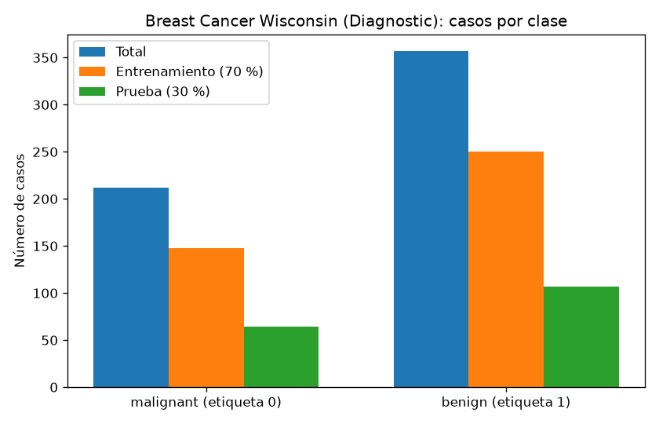
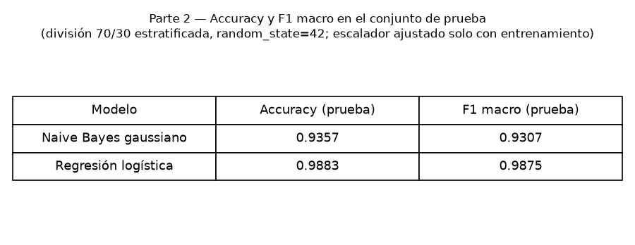
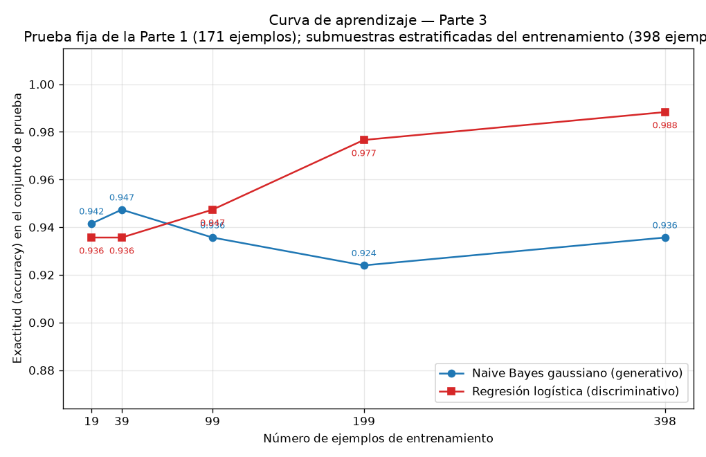

## Introducción

Ng y Jordan (2002) predijeron que un clasificador generativo alcanza su error asintótico con menos ejemplos que su par discriminativo, aunque ese error asintótico sea mayor. Esta tarea comprueba esa predicción sobre datos reales del conjunto Breast Cancer Wisconsin (Diagnostic), comparando un Naive Bayes gaussiano (generativo) contra una regresión logística (discriminativa) en una curva de aprendizaje sobre una única división entrenamiento/prueba.

## Metodología

Se cargó el conjunto con `sklearn.datasets.load_breast_cancer` (596 ejemplos, 30 atributos; 212 casos malignos y 357 benignos). Se creó una división 70 %/30 % estratificada por clase con `random_state=42`, que fue la única usada en toda la tarea: 398 ejemplos de entrenamiento (148 malignos, 250 benignos) y 171 de prueba (64 malignos, 107 benignos); las proporciones resultantes fueron 0.6995 y 0.3005. El conjunto de prueba no se usó para ajustar nada.

Se entrenaron dos modelos: un GaussianNB y una LogisticRegression (solver lbfgs, `random_state=42`). Para la regresión logística los atributos se estandarizaron con `StandardScaler` ajustado solo con el entrenamiento (verificado: la media del escalador coincide exactamente con la del entrenamiento y difiere de la de todos los datos, con diferencia máxima 4.1049). Para la curva de aprendizaje se reentrenaron ambos modelos con submuestras estratificadas del 5 %, 10 %, 25 %, 50 % y 100 % del entrenamiento (19, 39, 99, 199 y 398 ejemplos; `random_state=42`), evaluando siempre sobre el mismo conjunto de prueba de 171 ejemplos y transformándolo con el mismo escalador. Se midió exactitud (accuracy) y F1 macro.

## Resultados

Con el entrenamiento completo (398 ejemplos), las métricas sobre el conjunto de prueba fueron:

| Modelo | Accuracy (prueba) | F1 macro (prueba) |
|---|---|---|
| Naive Bayes gaussiano | 0.9357 | 0.9307 |
| Regresión logística | 0.9883 | 0.9875 |

La curva de aprendizaje, con la exactitud sobre el conjunto de prueba fijo, fue:

| % del entrenamiento | n ejemplos | Accuracy NB | Accuracy RL |
|---|---|---|---|
| 5 | 19 | 0.9415 | 0.9357 |
| 10 | 39 | 0.9474 | 0.9357 |
| 25 | 99 | 0.9357 | 0.9474 |
| 50 | 199 | 0.9240 | 0.9766 |
| 100 | 398 | 0.9357 | 0.9883 |

El Naive Bayes gaussiano tuvo mayor exactitud con 19 y 39 ejemplos (0.9415 y 0.9474 frente a 0.9357 de la regresión logística); la regresión logística superó al Naive Bayes a partir de 99 ejemplos (0.9474 frente a 0.9357) y amplió la ventaja hasta 0.9883 frente a 0.9357 con los 398 ejemplos.

## Discusión

Los dos modelos funcionan bien y se comportan de forma parecida. Hacen falta más estudios para sacar conclusiones.

## Cierre

Sobre la división fija 70/30 (398/171 ejemplos) del conjunto Breast Cancer Wisconsin, la regresión logística estandarizada superó al Naive Bayes gaussiano con el entrenamiento completo (accuracy 0.9883 contra 0.9357; F1 macro 0.9875 contra 0.9307). La curva de aprendizaje mostró el cruce predicho por Ng y Jordan: el generativo fue mejor con 19 y 39 ejemplos, el discriminativo desde 99 en adelante. El comportamiento es consistente con la teoría: el sesgo fuerte del Naive Bayes le da baja varianza y convergencia rápida a un error asintótico mayor, mientras que la regresión logística, con menor sesgo, necesita más datos para desplegar su ventaja asintótica.
